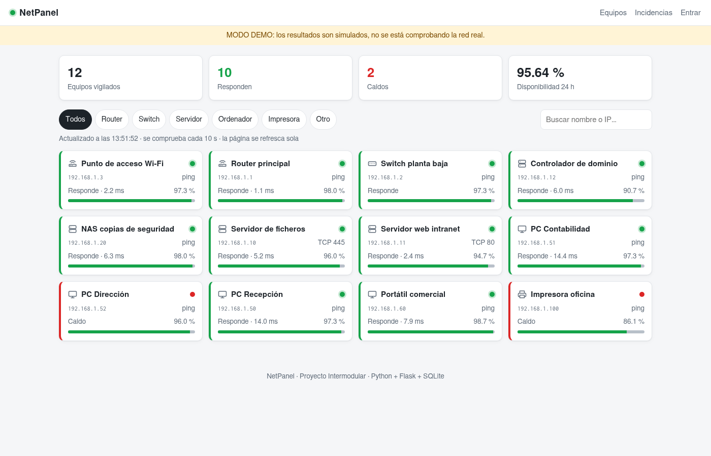

# NetPanel · Panel web de monitorización de equipos

Aplicación web en **Python + Flask + SQLite** que vigila los ordenadores, servidores, routers e impresoras de una red: indica si **responden** (ping/ICMP o conexión TCP), su **IP**, su **latencia** y su **historial de disponibilidad**, y registra cada caída y recuperación.

Proyecto Intermodular · curso 2026-2027.

🌐 **Web explicativa:** https://melvinfranco99.github.io/panel-monitorizacion-equipos/



## Funciones

- Comprobación periódica en paralelo por **ICMP** (ping) o **TCP** (puerto de un servicio).
- Un equipo se marca **caído** tras 2 fallos seguidos (evita falsas alarmas).
- Panel que se actualiza solo, con filtros y búsqueda; adaptado a móvil y modo oscuro.
- Ficha por equipo: disponibilidad 24 h / 7 d / 30 d, barras por tramos, gráfica de latencia, cambios de estado.
- Registro de incidencias y avisos opcionales por **Telegram**.
- Alta, edición y baja con usuario administrador; importación desde **CSV**.
- Seguridad: hash de contraseñas, CSRF, validación contra inyección de comandos, SQL parametrizado, escapado XSS.
- **Modo demo** (resultados simulados) y **laboratorio Docker** para entornos controlados.

## Inicio rápido

```bash
git clone https://github.com/melvinfranco99/panel-monitorizacion-equipos.git
cd panel-monitorizacion-equipos
python3 -m venv .venv && source .venv/bin/activate     # Windows: .venv\Scripts\activate
pip install -r requirements.txt
cp .env.example .env                                     # cambia la contraseña
python herramientas.py importar ejemplos/equipos_casa.csv
python run.py                                            # http://localhost:5000
```

**Demo sin red** (para presentaciones):

```bash
MONITOR_MODO_DEMO=1 python herramientas.py demo   # 12 equipos + 7 días de historial simulado
MONITOR_MODO_DEMO=1 python run.py
```

**Laboratorio Docker** (red 172.30.0.0/24 con equipos que puedes apagar):

```bash
cd lab && docker compose up -d --build            # http://localhost:5000  (admin / laboratorio)
docker compose stop pc-contabilidad               # simula una caída
```

**Producción** (Debian/Ubuntu/Raspberry Pi): `sudo bash deploy/instalar_linux.sh` y nginx con `deploy/nginx-netpanel.conf`.

## Pruebas

```bash
pip install -r requirements-dev.txt
python -m pytest -v        # 22 pruebas
```

## Estructura

```
panel/            aplicación Flask (config, db, comprobador, monitor, estadísticas, seguridad, rutas)
tests/            pruebas automáticas (pytest)
herramientas.py   importar CSV, comprobar desde consola, cargar demo
run.py / wsgi.py  arranque en desarrollo / producción (gunicorn)
lab/              laboratorio Docker Compose
deploy/           systemd, nginx y script de instalación
ejemplos/         CSV de ejemplo
memoria/          borrador de la memoria del proyecto
docs/             web explicativa (GitHub Pages)
```

## Documentación

| Página | Contenido |
|---|---|
| [Proyecto](https://melvinfranco99.github.io/panel-monitorizacion-equipos/) | Qué es, arquitectura, demo interactiva, comparativa |
| [Usar la app](https://melvinfranco99.github.io/panel-monitorizacion-equipos/uso.html) | Instalación, laboratorio, casa y empresa |
| [El código](https://melvinfranco99.github.io/panel-monitorizacion-equipos/codigo.html) | Explicación fichero a fichero |
| [Guía del proyecto](https://melvinfranco99.github.io/panel-monitorizacion-equipos/tfg.html) | Plan, qué aprender, memoria |
| [Defensa](https://melvinfranco99.github.io/panel-monitorizacion-equipos/defensa.html) | Guion de 20 min y preguntas del tribunal |

## Uso responsable

Monitoriza solo redes propias o con autorización expresa. No expongas el panel a Internet: usa una VPN.

Licencia MIT.
